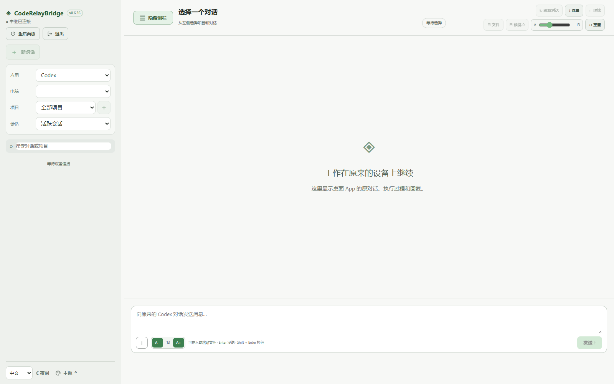

# CodeRelayBridge（CRB）

[English](README.en.md) · [下载安装](#下载与要求) · [使用指南](docs/USER_GUIDE.zh-CN.md)

在一个网页中使用多台电脑上的 Codex 和 DeepSeek Harness 桌面应用。通过电脑、平板或手机管理项目、继续对话、查看执行过程，并访问对应电脑的文件和终端。

## 界面预览

空白界面示例，未加载真实账号、设备或对话。

## 功能

- 同步原桌面应用的对话、执行状态、提问与审批。
- 跨应用、跨电脑的工作区，集中查看常用对话。
- 文件浏览、预览、编辑和对话附件。
- 多标签终端与文件预览，支持不同设备访问。
- 消息接收状态、明确重试和任务完成提示。
- 独立托盘客户端，可启动应用、管理连接与解除配对。
- 中英文界面、主题切换和字体调整。
- 签名更新清单、安装包校验与更新回滚。

各桌面应用支持的功能不同，面板会显示对应的可用操作。

## 下载与要求

[GitHub 发行版](https://github.com/Gabriel0224/CodeRelayBridge/releases)

按系统下载对应角色的最新安装包。各平台可独立更新，下表分别标明客户端和服务端的版本；无需从其他平台的发行版中查找。

| 平台 | 客户端 | 服务端 |
| --- | --- | --- |
| Windows x64 | [v0.6.65 · Setup.exe](https://github.com/Gabriel0224/CodeRelayBridge/releases/download/v0.6.65/RelayClient-0.6.65-Standard-Windows-x64-Setup.exe) | [v0.6.65 · Setup.exe](https://github.com/Gabriel0224/CodeRelayBridge/releases/download/v0.6.65/RelayServer-0.6.65-Standard-Windows-x64-Setup.exe) |
| Linux x64（Ubuntu / Mint） | [v0.6.65 · DEB](https://github.com/Gabriel0224/CodeRelayBridge/releases/download/v0.6.65/RelayClient-0.6.65-Standard-Linux-x64.deb) | [v0.6.65 · DEB](https://github.com/Gabriel0224/CodeRelayBridge/releases/download/v0.6.65/RelayServer-0.6.65-Standard-Linux-x64.deb) |
| macOS 27+ Apple Silicon | [v0.6.65 · DMG](https://github.com/Gabriel0224/CodeRelayBridge/releases/download/v0.6.65/RelayClient-0.6.65-Standard-macOS27-arm64.dmg) | [v0.6.65 · DMG](https://github.com/Gabriel0224/CodeRelayBridge/releases/download/v0.6.65/RelayServer-0.6.65-Standard-macOS27-arm64.dmg) |

客户端和服务端是独立程序。完整安装包包含 Python、Qt 和运行依赖；Linux 可能还需要系统图形库。原 Codex／DeepSeek Harness 桌面应用需另外安装并登录。

此仓库提供普通版源码和安装包。普通版不依赖 Cockpit；Cockpit 集成版通过单独的私有仓库提供。

## 快速开始

1. 在一台电脑上安装服务端，在需要接入的电脑上安装客户端。
2. 在服务端设置监听地址、访问地址及网页登录账号，启动服务。
3. 用浏览器打开访问地址，确认能够登录。
4. 在客户端选择“配对 / 添加应用”，填写服务端地址和网页登录账号，选择应用后接入。
5. 在网页选择应用、电脑、项目或工作区，打开对应对话。

同一台电脑可以同时安装客户端和服务端。跨地点使用时，可通过 Tailscale 或 ZeroTier 建立私有网络；手机也需加入相应网络。公网访问需单独配置 HTTPS 和访问控制。

详细步骤：[中文使用指南](docs/USER_GUIDE.zh-CN.md) · [English user guide](docs/USER_GUIDE.en.md)

## 同时使用 Tailscale 与 v2rayN

先看 v2rayN 的 TUN 开关，再选择对应步骤：

- **未开 TUN**：将面板实际的 Tailscale IP／MagicDNS 名称加入代理例外 → 保存并重新应用 → 测试网页登录。通常不用添加进程规则。
- **已开 TUN**：先设置上述例外 → 排除 Tailscale 网段 → 重载 TUN 并测试；仍异常时，再添加 `tailscaled.exe` 等直连规则。

**未开启 TUN 不等于完全没有影响。** PAC 或浏览器独立代理也要在各自配置中放行面板地址，不必将整个浏览器或 Codex 强制直连。

[按步骤配置：填写位置、内容及验证方法](docs/USER_GUIDE.zh-CN.md#71-同时使用-tailscale-与-v2rayn)

## 更新与安全

网页左下角“反馈”可打开本仓库的 GitHub Bug 表单，需要登录 GitHub。仅预填 CRB 版本，不自动上传日志、聊天或设备信息；提交前请自行脱敏。

在客户端或服务端中选择“检查 CRB 更新”。确认安装后，程序会校验签名和安装包，保留配对与设置，并重新启动 Relay。更新期间连接和网页终端会短暂中断，不会重启原桌面 AI 应用。

配对允许访问目标电脑的文件、终端和应用。请只连接可信服务端，公网使用 HTTPS，不要公开连接凭据或私钥。[安全说明](SECURITY.md)

## 开发与许可

[开发与构建](DEVELOPMENT.md) · [更新说明](UPDATES.md)

项目自有代码采用 [PolyForm Noncommercial 1.0.0](LICENSE)，限非商业用途。第三方组件保留各自许可，详见 [许可范围](LICENSING.md) 和 [第三方声明](THIRD_PARTY_NOTICES.md)。

作者：Gabriel

[Gitee 仓库](https://gitee.com/gabriel0224/CodeRelayBridge)
